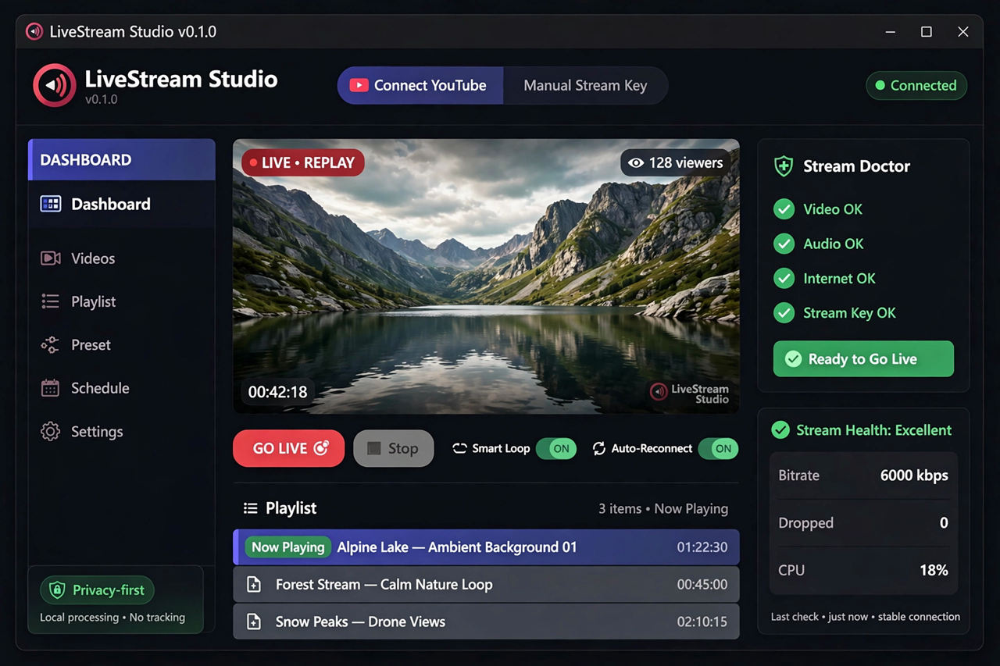

# Looprix v0.1.0

> **Developed by [Bidyut Roy](https://github.com/BidyutRoy2)** — Full-Stack & Web3 Developer

A lightweight **Windows 10/11 desktop app** (Tauri v2 + React + Rust + FFmpeg, ~15 MB target) that streams a pre-recorded video or playlist as **YouTube Live via RTMPS**.

Pick a video → press **GO LIVE** → your video plays on YouTube Live. No OBS complexity, no monthly fee, no cloud upload.



## v0.1.0 — what is inside

- **Dual connect** — (a) Connect YouTube via OAuth 2.0 + YouTube Data API v3 (`liveBroadcasts.insert` + `liveStreams.insert` + `bind`, `enableAutoStart: true`, `enableAutoStop: false`), (b) Manual Stream Key — paste Stream URL (default `rtmps://a.rtmps.youtube.com/live2`) + Stream Key. One switch in the top bar; both feed the same FFmpeg engine.
- **Smart Loop** — Repeat One / Repeat All / Shuffle, Gapless Loop (no black frame), drag-drop reorder, search.
- **Auto-Reconnect** — reconnect within ~3s on drop, with backoff (3s → 6s → 12s → 30s cap) and honest status.
- **Preset + Custom** — Lofi Radio (720p 2500 kbps), Waz (1080p 6000 kbps), Quran Recitation, Music, Nature, Education, News, Podcast. One click sets resolution / fps / bitrate / audio / overlay / loop / latency / title template. Quality chips: Data Saver / Standard / Smooth / Auto. **My Custom Presets**: create / edit / duplicate / delete / Save as Custom / export-import. No preset is excluded.
- **Stream Doctor** — pre-flight check: Video OK, Audio OK, Internet OK, Stream Key OK. All green = `Ready to Go Live`; any red blocks Go Live with a plain reason.
- **Overlay badge + logo** — `LIVE • REPLAY` badge (auto REPLAY for pre-recorded) + logo watermark bottom-right, toggleable.
- **Schedule** — weekly calendar, Add Schedule, Auto Start ON, Auto Stop ON (e.g. Fri 8:00 PM – 11:00 PM).
- **Privacy-first / 100% secure by design** — local-only, no cloud upload, no telemetry/tracking, no account/signup. Stream Key + OAuth tokens are encrypted at rest in the OS credential store (Windows DPAPI / Credential Manager). RTMPS only, never plain RTMP by default. No admin rights at runtime. No remote code download. See [docs/SECURITY.md](docs/SECURITY.md).

## Coming in v1.0 (not in v0.1.0)

Auto bitrate drop, 11h auto restart, Ticker + Countdown, Audio normalize −14 LUFS, Multi-stream (Facebook / Twitch).

## Download (Windows, no build needed)

Get the installer from the
[latest release](https://github.com/BidyutRoy2/looprix/releases/latest):
`Looprix_0.1.0_x64-setup.exe` (installer), the `.msi`, or
`Looprix-Portable-0.1.0.zip` (no install — unzip and run `Looprix.exe`).
The release is built automatically by GitHub Actions on every `v*` tag
(see `.github/workflows/release.yml`).

> The installer is **not code-signed**, so Windows SmartScreen may warn
> "Unknown publisher" on first install — click **More info → Run anyway**.
> The release is built from this exact source on GitHub's Windows runner.

## Quick start (Windows)

1. Download the installer from the [latest release](https://github.com/BidyutRoy2/looprix/releases/latest) and run it.
2. YouTube Studio → Create → Go Live → enable Live (first time can take up to 24h).
3. In the app pick **Manual Stream Key** (simplest) or **Connect YouTube**.
   - Manual: copy Stream URL + Stream Key from YouTube Studio, paste, **Save Key Securely**.
4. Add videos (drag-drop), pick a Preset (e.g. **Waz**), run **Stream Doctor**.
5. Press **GO LIVE**. When Stream Doctor is green, YouTube shows the preview — click **Go Live** in Studio if it does not auto-start.

Honest labelling: a pre-recorded video is shown with a **REPLAY** badge. Do not present old footage as a live breaking event, and only stream content you own or are licensed to use.

## Build from source (Windows)

See [docs/BUILD.md](docs/BUILD.md). Short version:

```powershell
# Needs: Rust (rustup), Node.js 20+, Tauri CLI
.\scripts\build-windows.ps1
# Output: src-tauri\target\release\bundle\nsis\Looprix_0.1.0_x64-setup.exe
```

## Tests

```bash
npm install
npm test        # vitest — presets, FFmpeg command builder, Stream Doctor, schedule, secret redaction
npm run build   # tsc + vite build
```

## Developer

**Developed by [Bidyut Roy](https://github.com/BidyutRoy2)** — Full-Stack & Web3 Developer.
GitHub profile: https://github.com/BidyutRoy2

## License

MIT — see [LICENSE](LICENSE).
